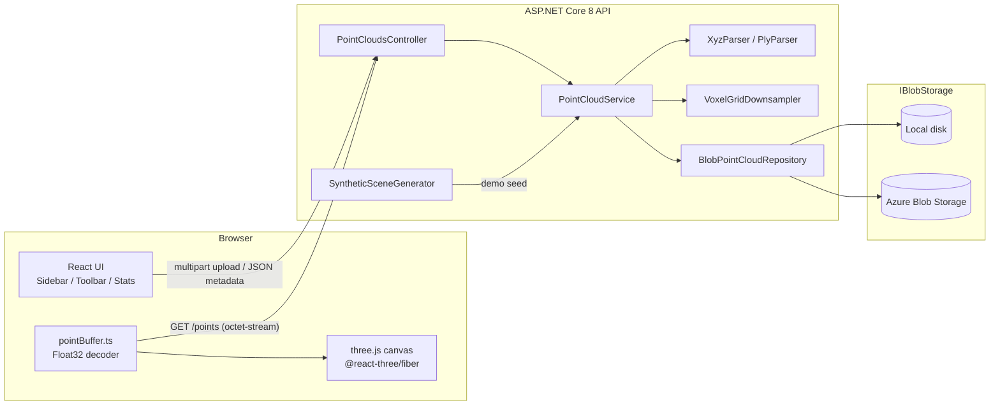

# Point Cloud Viewer

A web-based 3D viewer for LiDAR / photogrammetry point clouds. An ASP.NET Core 8 API ingests
ASCII `.xyz` and `.ply` scans, parses them in a streaming, fault-tolerant way, computes
statistics (point count, bounding box, centroid), builds a voxel-grid level of detail, and
serves points to the browser as a compact binary Float32 buffer. A React 18 + three.js client
renders the cloud on the GPU with orbit navigation, RGB or height colouring, adjustable point
size and fit-to-view. A deterministic synthetic site scan is generated on first start so there
is always something to look at.

> **Screenshot:** not included yet. Run the app locally (see below) and the demo site scan
> loads automatically.

## Features

**API**

- Upload ASCII point clouds via `multipart/form-data`
  - XYZ family (`.xyz`, `.txt`, `.csv`, `.pts`): `x y z [r g b]`, separated by spaces, tabs,
    commas or semicolons; `#` / `//` comments and blank lines ignored
  - ASCII PLY: `vertex` element with `x y z` and optional `red green blue` (integer 0-255 or
    float 0-1 colour types); binary PLY is rejected with `415`
- Streaming line-by-line parsing that skips malformed lines (non-numeric, too few columns,
  NaN/Infinity) and reports how many were skipped plus the first few warnings with line numbers
- Statistics: point count, axis-aligned bounding box, centroid
- **Voxel-grid downsampling**: each occupied voxel is replaced by the centroid of its points
  with averaged colour. The voxel size is configurable, or derived automatically by a
  log-space bisection that hits a target LOD point budget (works for flat terrain as well as
  volumetric scenes)
- Points endpoint picks the most detailed stored level that fits the requested `maxPoints`
  (full -> voxel LOD -> uniform decimation) and returns interleaved little-endian Float32
  `[x, y, z, r, g, b]`, or JSON
- Positions are stored relative to the bounding-box centre so large georeferenced
  coordinates (e.g. UTM) keep full precision in 32-bit floats; the origin is returned in a header
- Storage behind an `IBlobStorage` abstraction with a **local disk** provider (default) and an
  **Azure Blob Storage** provider (`Azure.Storage.Blobs`), selected by configuration
- Upload size limits (default 200 MB) and a per-dataset point cap (default 5 M)
- RFC 7807 `ProblemDetails` for every error (400/404/413/415/422/500), Swagger/OpenAPI,
  health check, CORS for the dev client, structured logging with source-generated `LoggerMessage`
- Synthetic demo scene generator (terrain, road, plaza, a four-storey building with windows,
  trees; ~150k coloured points, deterministic per seed) seeded in the background on first start

**Client**

- Dataset list sidebar with upload and delete
- three.js rendering via `@react-three/fiber` with a single `BufferGeometry` draw call
- Orbit / pan / zoom (`OrbitControls`, Z-up), axis gizmo
- Colour modes: scan RGB or an elevation (height) ramp with legend
- Point size slider and point budget selector (250k - 5M)
- Stats panel: total and displayed points, sampling level, LOD voxel size, bounds, centroid,
  source size, skipped malformed lines
- Fit-to-view button (or press <kbd>F</kbd>) that frames the cloud's bounding sphere

## Tech stack

| Area | Technologies |
| --- | --- |
| Backend | C# 12, .NET 8, ASP.NET Core Web API (controllers), Swashbuckle, Azure.Storage.Blobs |
| Frontend | React 18, TypeScript 5, Vite 5, three.js, @react-three/fiber 8, @react-three/drei 9 |
| Testing | xUnit, `WebApplicationFactory` integration tests, Vitest |
| DevOps | Docker (multi-stage), docker-compose, nginx, GitHub Actions |

## Architecture



Import pipeline: **parse** (stream, skip bad lines) -> **statistics** (bounds, centroid) ->
**LOD** (estimate voxel size, downsample) -> **store** `clouds/{id}/full.bin`, `lod.bin`, and
finally `metadata.json` (written last so a dataset only appears once its buffers are complete).

## Project structure

```
point-cloud-viewer/
├── src/
│   ├── PointCloudViewer.Core/            # Domain, parsing, processing, application services (no ASP.NET dependency)
│   │   ├── Domain/                       # PointRecord, BoundingBox, CloudStatistics, metadata
│   │   ├── Parsing/                      # XyzParser, PlyParser, parser resolver, tokenizer
│   │   ├── Processing/                   # VoxelGridDownsampler, VoxelSizeEstimator, PointBufferCodec
│   │   ├── Application/                  # PointCloudService, blob-backed repository
│   │   ├── Samples/                      # SyntheticSceneGenerator
│   │   └── Storage/                      # IBlobStorage abstraction
│   ├── PointCloudViewer.Infrastructure/  # LocalDiskBlobStorage, AzureBlobStorage, DI
│   └── PointCloudViewer.Api/             # Controllers, contracts, ProblemDetails handler, demo seeder, Dockerfile
├── tests/PointCloudViewer.Tests/         # xUnit unit + integration tests
├── client/                               # React + Vite + three.js viewer, Dockerfile, nginx.conf
├── docker-compose.yml
└── .github/workflows/ci.yml
```

## Running locally

### Prerequisites

- [.NET 8 SDK](https://dotnet.microsoft.com/download/dotnet/8.0)
- Node.js 20+ and npm

### API + client (development)

```bash
# Terminal 1 - API on http://localhost:5080 (Swagger at /swagger)
dotnet run --project src/PointCloudViewer.Api

# Terminal 2 - client on http://localhost:5173 (proxies /api to :5080)
cd client
npm ci
npm run dev
```

On first start the API generates the demo site scan in the background; the client polls until
it appears. Uploaded data is written to `src/PointCloudViewer.Api/data/` (git-ignored).

Try uploading your own file, for example a minimal XYZ:

```text
# x y z r g b
0 0 0 255 0 0
1 0 0 0 255 0
0 1 0 0 0 255
0 0 1 255 255 255
```

### Docker

```bash
docker compose up --build
```

| Service | URL |
| --- | --- |
| Client (nginx, proxies `/api`) | http://localhost:8080 |
| API + Swagger | http://localhost:5080/swagger |

Datasets persist in the `pointcloud-data` volume. The Docker files have not been run on the
author's machine yet (see [Known limitations](#known-limitations)).

## Running tests

```bash
# Backend: unit + WebApplicationFactory integration tests
dotnet test

# Frontend: Vitest unit tests (buffer decoding, colour ramp, camera maths, formatting)
cd client
npm test
```

Backend tests cover XYZ/PLY parsing (delimiters, comments, colour handling, malformed and
binary input), voxel downsampling (centroids, colour averaging, expected voxel counts, bounds preservation), voxel size
estimation, bounding box and statistics maths, the binary codec, the synthetic generator's
determinism, the local disk storage provider, and the HTTP API end to end (upload, list, get,
binary/JSON points, LOD selection, delete, 400/404/413/415/422 problem responses).

## API

| Method | Route | Description | Success |
| --- | --- | --- | --- |
| `POST` | `/api/clouds` | Upload a point cloud (`multipart/form-data`: `file`, optional `name`) | `201` + metadata |
| `GET` | `/api/clouds` | List dataset metadata, newest first | `200` |
| `GET` | `/api/clouds/{id}` | Metadata: counts, bounds, centroid, origin, LOD info, warnings | `200` / `404` |
| `GET` | `/api/clouds/{id}/points?maxPoints=N&format=binary\|json` | Points (default binary, `maxPoints` 1 - 5,000,000, default 1,000,000) | `200` / `400` / `404` |
| `DELETE` | `/api/clouds/{id}` | Delete a dataset and its stored files | `204` / `404` |
| `GET` | `/health` | Health check | `200` |

Binary point responses are `application/octet-stream` with 24 bytes per point
(`[x, y, z, r, g, b]` little-endian Float32, positions relative to the origin, colours 0-1) and
these headers:

| Header | Meaning |
| --- | --- |
| `X-Point-Count` | Points in this response |
| `X-Point-Total-Count` | Points in the full dataset |
| `X-Point-Stride` | Floats per point (6) |
| `X-Point-Origin` | `x,y,z` offset to add back for world coordinates |
| `X-Point-Sampling` | `Full`, `VoxelLod` or `Decimated` |

Example:

```bash
curl -F "file=@scan.xyz" -F "name=Car park" http://localhost:5080/api/clouds
curl http://localhost:5080/api/clouds
curl -o points.bin -D - "http://localhost:5080/api/clouds/<id>/points?maxPoints=200000"
```

### Configuration

| Key | Default | Description |
| --- | --- | --- |
| `Storage:Provider` | `LocalDisk` | `LocalDisk` or `AzureBlob` |
| `Storage:LocalDisk:RootPath` | `data` | Relative to the content root |
| `Storage:AzureBlob:ConnectionString` | _(empty)_ | Required for `AzureBlob`; `UseDevelopmentStorage=true` for Azurite |
| `Storage:AzureBlob:ContainerName` | `point-clouds` | Created if missing |
| `Upload:MaxFileSizeBytes` | `209715200` | 200 MB |
| `PointCloud:MaxPoints` | `5000000` | Points per dataset |
| `PointCloud:LodTargetPoints` | `250000` | Target size of the auto-sized LOD |
| `PointCloud:LodVoxelSize` | _(unset)_ | Fixed LOD voxel size instead of the target |
| `DemoData:Enabled` / `Density` / `Seed` | `true` / `1.0` / `7` | Demo scene seeding |
| `Cors:AllowedOrigins` | `[]` (dev: `http://localhost:5173`) | Origins allowed to call the API directly |

Environment variables use `__` as the separator, e.g. `Storage__Provider=AzureBlob`.

## Azure deployment notes

The app is designed to map onto standard Azure services (no infrastructure-as-code is
included yet):

- **API** -> Azure App Service (Linux, .NET 8) or Azure Container Apps using
  `src/PointCloudViewer.Api/Dockerfile`.
- **Storage** -> set `Storage__Provider=AzureBlob` and point it at a Storage Account container.
  Keep the connection string in Key Vault / App Service settings, never in source. For
  production, switch `AzureBlobStorage` construction to `DefaultAzureCredential` with a managed
  identity (a comment in `DependencyInjection.cs` marks the spot) so no key is needed at all.
- **Client** -> Azure Static Web Apps (or Blob static website + CDN). Either set
  `VITE_API_BASE_URL` at build time and add the site origin to `Cors__AllowedOrigins`, or route
  `/api` to the backend.
- Raise App Service / Front Door request size limits if uploads larger than the defaults are
  needed, and consider direct-to-Blob uploads with SAS tokens for very large scans.

## Known limitations

- ASCII formats only; binary PLY, LAS/LAZ and E57 are not supported.
- The parser streams the file, but the parsed cloud is held in memory during import, so very
  large files are bounded by API memory (hence the 5 M point cap).
- Height colouring uses the Z axis; data must be Z-up.
- The Dockerfiles and docker-compose stack were written but not executed locally; CI builds and
  tests the code without Docker.

## License

[MIT](LICENSE)
